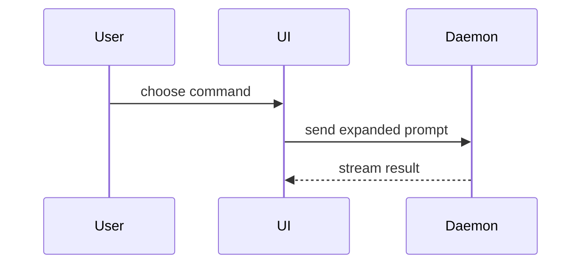

# PR shape

The title and the three sections of a PR body, for a reviewer who hasn't read the ticket or the commits. `pr-ticket` and `execute-ticket` both write them. The header lines and `For the reviewer` come from the station's own `SKILL.md`, so they aren't here.

## Title

```text
<type>: <id> <short title>
```

Copy the ticket title, which is already in this shape. The id is the `(N.M)` an epic task carries, and a standalone ticket has none. The ticket `feat: (3.2) Add OAuth login` opens the PR `feat: (3.2) Add OAuth login`.

- The type is `feat` or `fix`, as the ticket says.
- Add `!` after the type for a breaking change, as in `feat!:` or `fix!:`. That is the one edit the title gets.

The prefix follows Conventional Commits. A PR merges into main as one squash commit whose subject is the PR title, and release tooling reads the type from that subject to pick the next version. `fix` raises the patch number, `feat` the minor, and `!` the major.

Write Merge danger first, because the breaking call reads its Blast radius lines.

### Breaking change

A change is breaking when code outside this repo, calling its public interface, stops working or behaves differently after the merge. The public interface is whatever outside code reaches, such as a published API, a library's exported names, a CLI's flags and output, or a file format another program reads. Both kinds of Blast radius line count when the thing changed is public:

- **Signature.** A public name, parameter, return type or thrown error changed.
- **Behaviour.** A public name kept its signature but changed what callers see, such as a default, an error format or an output shape.

Internal changes never count, however large. A renamed private function or a reshaped module isn't breaking, and a repo that publishes nothing has no breaking changes. When you can't tell whether a name is public, mark it breaking and name it in Blast radius. A wrong `!` costs a major bump. A missing one ships a break as a minor update.

### Squash merge

The prefix only reaches main if the repo squash-merges with the PR title as the subject. Check it with:

```
gh api repos/{owner}/{repo} --jq '[.allow_merge_commit, .allow_rebase_merge, .squash_merge_commit_title]'
```

Anything but `[false,false,"PR_TITLE"]` lets a merge reach main without the prefix. Say so in the station's report, and never change the repo settings yourself.

## Body

```markdown
## Summary

<one or two lines, what changed and why, in the ticket's words>

<diagram, diff sketch, or tree>

## Evidence

**Before** `<red sha>`, these tests failed.
**After** `<HEAD sha>`, they pass. <what else ran green, such as the whole suite, 214 tests>

- <behaviour, in the ticket's words> `<test file>::<test name>`

## Merge danger

### Door
<One-way or two-way>. <optional, one line on why>

### Blast radius (Hyrum's law)
<One word>.
- Signature: <changed public signature>. <who breaks>
- Behaviour: <observable change behind an unchanged signature>. <who relied on it>

### Untested behaviour (Beyoncé rule)
- <behaviour the diff adds or changes>. No test asserts it.
```

Skip preambles and keep prose short. Use the project's terms as `CONTEXT.md` defines them, when the file exists. A reviewer reads the body cold, so never coin a term the code or `CONTEXT.md` doesn't use. Check every line against `unslop`.

## Summary

Lead with one or two lines of prose, then pick the smallest view that makes the change clear. One view is the usual answer and three is the most. Put each view next to the line it supports. Show only the calls, files, props, states and boundaries the reviewer needs. Leave docstrings out of code blocks.

### Feature work gets a sequence diagram

A ticket that adds user-visible behaviour or a new entry point gets a Mermaid `sequenceDiagram`, showing the new path through the components it crosses. Draw the path a user's action takes, not every call in the diff. Skip the diagram only when the feature lives inside one component and crosses no boundary, and then use one of the other views.

Refactors, bug fixes and test-only changes get a diagram only when the change alters which components call each other, or in what order.



GitHub draws a `mermaid` code fence as a diagram, but its Mermaid version trails the current one, and a diagram it can't parse shows as an error box. Stay inside this syntax:

- `participant` and `actor`, with plain one-word names. Never name one `end`.
- `->>` for a call, `-->>` for a reply, `-x` for a failure.
- `alt` / `else` / `end`, `opt` / `end`, `loop` / `end`.
- `Note over A,B: text`.
- No semicolons or `#` in message text. Both break the parser.

### Other views

Logic or an algorithm, as pseudocode:

```text
on(save)
  if content is unchanged
    return cached result
  write new content
  return fresh result
```

Runtime control flow, as a call tree:

```text
submitForm
  createSession
    persistPrompt
    launchAgent
  navigateToSession
```

UI structure, as a component tree with the state and module boundaries that matter:

```text
<SessionPage> (apps/example/src/routes/session.tsx)
  useSessionEvents()
  <SessionToolbar>
    <RunSkillButton> (packages/ui)
```

File responsibility or a broad refactor, as a shallow file tree:

```text
src/
├── commands/       # parses user actions
├── sessions/       # owns session state
└── transport/      # sends API requests
```

### Diff sketches

Use a `diff` fence when the point is what changed and the surrounding shape already exists. Match the sketch to the view it changes.

A component change:

```diff
 <SessionPage>
   useSessionEvents()
   <SessionToolbar>
+    <RunSkillButton />
   <SessionTimeline>
+    <SkillResultCard />
```

A file layout change:

```diff
 src/
 ├── commands/
+│   └── show-me.ts       # expands the slash command
 ├── sessions/
-└── transport.ts
+└── transport/
+    ├── client.ts
+    └── stream.ts
```

A call tree change:

```diff
 submitForm
   createSession
     persistPrompt
+    expandSkillMention
     launchAgent
-  navigateToSession
+  navigateToSession
+    subscribeToEvents
```

A state or control flow change:

```diff
 on(save)
-  write content
+  if content is unchanged
+    return cached result
+  write new content
+  invalidate cache
```

Show a whole code block instead when most of it is new, when cutting context would hide ownership or order, or when the reviewer needs the target shape to copy:

```ts
function expandSkill(command: string): string {
  const skillName = command.slice(1);
  return `use the ${skillName} skill`;
}
```

## Evidence

The tests are the evidence. Before is the red commit, where every test the ticket added was watched failing. After is `HEAD`, where the same tests pass.

- **On the kanban chain**, the red commit is `Architect #<N>:`. The tests have since moved into the module test files `unit-test-ticket` folded them into, so take each one's file at `HEAD` from the `Tests #<N>: tidy and fold` commit or `unit-test-ticket`'s issue comment. Leave dropped tests out. The whole suite ran green, so say so with its count.
- **On `execute-ticket`**, the red commit is `Test #<N>:`, and the tests are still where it wrote them. It ran its own tests and the neighbouring tests, not the whole suite, so say exactly that.

List one line per test: the behaviour in the ticket's words, then the test's file and name at `HEAD`. Never claim a test passed or failed without a run or a commit that says so.

## Merge danger

Three parts, each under its own `###` heading exactly as named below, law names included, so a reviewer can spot each one. A part with nothing to flag says `none` rather than being left out, so the reviewer knows the check ran. You flag and never fix. A missing test or a risky change goes in the body, not into a commit.

### Door

A two-way door can be walked back by reverting the merge. A one-way door can't: a data migration, a deleted column, a published API or file format, a message sent to users. Say which, and for a one-way door, name what can't be undone.

### Blast radius (Hyrum's law)

One word for how far a bad merge reaches, such as `module`, `service`, `consumers` or `users`. Then one line per thing a caller could notice, in two kinds:

- **Signature.** A public name, parameter, return type or thrown error changed. Name who calls it and breaks.
- **Behaviour.** The signature stayed the same, but something a caller can observe changed: the order of a returned list, an error message's text, a default value, timing, a file or output format, stored data. With enough callers, someone depends on every observable behaviour, whether or not anyone promised it. These are the ones a reviewer can't spot from the signatures, so look hardest for them.

Think past the diff to what reads its output, such as a config another repo reads or layout on small screens.

### Untested behaviour (Beyoncé rule)

Behaviour with no test is unprotected, and the next change can break it without the suite noticing. List every behaviour the diff adds or changes that no test asserts, one line each.

- **Scope is the diff.** Only code the diff touches. Old gaps elsewhere aren't this PR's to flag.
- **Use the coverage tool if the project has one.** Run it over the suite and list changed lines no test executed, each named as the behaviour it carries.
- **Otherwise read.** For each changed path, such as a branch, an error case or a new return value, find a test that asserts it. Executing the line isn't enough. A test has to check the result.

The ticket's own Behaviour lines are already covered by the evidence tests, so what turns up here is usually an extra error path, a guard, or old behaviour the diff changed that never had a test.
